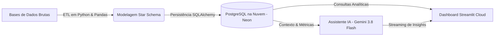

# 💻 Paulo Cid | Developer Portfolio — Software & Data Engineering

<div align="center">

[](https://paulocid.vercel.app)
[](https://paulocid.vercel.app)

<br/>

[](https://developer.mozilla.org/pt-BR/docs/Web/HTML)
[](https://developer.mozilla.org/pt-BR/docs/Web/CSS)
[](https://developer.mozilla.org/pt-BR/docs/Web/JavaScript)
[](https://tailwindcss.com/)
[](https://react.dev/)
[](https://vercel.com/)
[](LICENSE)

<p align="center">
  <strong>Interface Web Imersiva &bull; Dark UI Futurista &bull; Animações em Tempo Real a 60 FPS &bull; Engenharia de Software e Dados</strong>
</p>

</div>

---

## 📌 Visão Geral do Projeto

Este repositório contém o código-fonte do portfólio oficial de **Paulo Cid**, estudante de **Ciência da Computação** com atuação direcionada a **Engenharia de Dados**, **Desenvolvimento Back-end/Full-stack** e **Inteligência Artificial Aplicada**.

Projetado sob uma estética **Dark UI / Cyberpunk Minimalista**, a aplicação une alto rigor visual e fluidez com engenharia de front-end refinada. O ambiente conta com efeitos ópticos avançados, renderização em tempo real via Canvas e WebGL, áudio ambiente imersivo com equalizador ativo e uma arquitetura orientada a componentes modulares (Vanilla JS & JSX).

> [!NOTE]
> Acesse a experiência completa em produção: **[paulocid.vercel.app](https://paulocid.vercel.app)**.

---

## 🎨 Destaques Visuais e Engenharia de UI/UX

A interface foi concebida para oferecer uma experiência marcante logo no primeiro contato, sem comprometer a performance e a acessibilidade.

```
   ┌────────────────────────────────────────────────────────┐
   │                  EXPERIÊNCIA IMERSIVA                  │
   ├───────────────────┬───────────────────┬────────────────┤
   │    Abertura       │  Interatividade   │  Áudio & BGM   │
   │  Splash Screen    │   Ghost Fibers    │  AudioPlayer   │
   │  HUD Particles    │   Glow Cursor     │  Visualizer    │
   │  WarpText Fluid   │   Touch Ripple    │  Persistência  │
   └───────────────────┴───────────────────┴────────────────┘
```

### 1. 🌌 Splash Screen & Partículas (`SplashParticles.js` & `SplashScreen.css`)
- **HUD Interativo & Grid 3D:** Tela de entrada com perspectiva tridimensional, brilho atmosférico sci-fi e grade de fundo imersiva.
- **Sistema de Partículas em Canvas:** Partículas dinâmicas e reativas ao ponteiro/toque geradas por cálculo trigonométrico em 60 FPS.
- **Logotipos Neon Flutuantes:** Ícones de tecnologias centrais (Python, PostgreSQL, MySQL e GitHub) com efeitos de iluminação e reflexos cibernéticos.

### 2. ⚡ Efeitos Visuais Reativos e Tipografia Fluida
- **Refração e Distorção Fluida (`WarpText.js` / `WarpText.jsx`):** Tipografia dinâmica com shader de refração, ondulação de ondas senoidais e resposta ao movimento do cursor.
- **Fibras Óticas Etéreas (`GhostFibers.js` / `GhostFibers.jsx` / `GhostFibers.css`):** Filamentos luminosos contínuos renderizados em canvas, simulando fibras óticas profundas que reagem à navegação.
- **Cursor Luminoso Volumétrico (`GlowCursor.js` / `GlowCursor.jsx`):** Seguidor de ponteiro com atenuação por amortecimento (*smooth dampening*), rastro com decaimento exponencial suave em velocidade e sem aberrações circulares estáticas.
- **Bordas Estelares (`StarBorder.jsx` / `StarBorder.js` / `StarBorder.css`):** Gradientes luminosos em rotação contínua com aceleração dinâmica no hover (*hover lap*) e dispersão de pulso luminotécnico ao clique.
- **Feedback Tátil (`TouchRipple.js` & `Mobile.css`):** Sistema de ondas de contato (*touch ripples*) e menu off-canvas responsivo construído especialmente para smartphones e tablets.

### 3. 🎬 Orquestração de Scroll & Animações Dinâmicas (`AnimatedContent.js` & GSAP)
- **Revelação Procedural Orientada a Scroll:** Sistema desacoplado com GSAP e `IntersectionObserver` para entrada suave de seções e cartões com *staggered delay* e curvas `power3.out`.
- **Eliminação de FOUC:** Prevenção de oscilações (*Flash of Unstyled Content*) sincronizada com a finalização do HUD da Splash Screen.
- **Hero Interativo com Indicador Dinâmico de Contatos:** Microinteração com transição suave e sequencial de ícones dos canais profissionais a cada 2 segundos.

### 4. 🎵 Player de Áudio Integrado (`AudioPlayer.js` & `AudioPlayer.css`)
- **Música Ambiente Contínua:** Trilha sonora sintetizada em loop com reprodução suave e sem interrupções durante a navegação.
- **Equalizador Gráfico Animado:** 4 barras equalizadoras reativas sincronizadas com o estado da reprodução (`playing` / `paused`).
- **Controles Completos:** Play/Pause, Mute com salvamento de estado e controle linear deslizante de volume.
- **Widget Retrátil:** Pode ser recolhido para uma cápsula discreta no canto inferior direito da tela, além de possuir um mini-controlador integrado à barra de navegação mobile.

### 5. 📑 Currículo Profissional Interativo & Arquitetura Web-to-Print (`curriculo.html`)
- **Interface Dual (Web & Impressão A4 Pixel-Perfect):** Diagramação vetorial responsiva desenvolvida especificamente para renderizar em alta fidelidade na tela e com encaixe perfeito em folha A4 via CSS `@media print`.
- **Alternância Dinâmica de Tema:** Seletor de Modo Claro e Escuro com tokens customizados de contraste e persistência automática em `localStorage`.
- **Navegação Inteligente & Sincronização de Abas:** Toolbar com atalhos diretos para impressão nativa (`window.print()`), download de PDF oficial com efeito `StarBorder` e controle de encerramento (`window.close()` com fallback para histórico).

---

## 📦 Projetos em Destaque no Portfólio

O portfólio serve como vitrine para soluções reais de engenharia, destacando a união entre análise preditiva, automação e inteligência artificial:

### 🏆 Supply Intelligence: Pipeline de Dados & Assistente de IA para Estoque
Uma plataforma completa de engenharia de dados e inteligência artificial para otimização de suprimentos e previsão de rupturas de estoque:



- **Pipeline ETL com Python & Pandas:** Tratamento, higienização, deduplicação e normalização de bases transacionais de estoque e compras.
- **Modelagem Dimensional (Star Schema):** Tabelas fato e dimensão estruturadas para alta performance analítica persistidas em PostgreSQL hospedado na nuvem (**Neon Database**) com **SQLAlchemy**.
- **Dashboard Executivo no Streamlit Cloud:** Visualização em tempo real de KPIs de giro, curva ABC, ponto de reposição e eficiência de capital.
- **Assistente Virtual com Google Gemini (`gemini-3.8-flash`):** Chatbot conversacional com respostas em tempo real (streaming) especializado em diagnóstico de rupturas de fornecimento, análise estratégica de *lead time vs. preço* e geração automatizada de relatórios de compras.

---

## 📂 Estrutura de Arquivos do Repositório

Organização modular baseada em separação de responsabilidades para estilização, renderização de efeitos e lógica de apresentação:

```plaintext
paulo-cid-portfolio/
├── 📄 index.html              # Estrutura principal semântica (SPA) com Tailwind CSS
├── 📄 curriculo.html          # Currículo profissional interativo e arquitetura Web-to-Print A4
├── 📄 curriculo.pdf           # Documento PDF oficial para download direto
├── 📁 curriculo/              # Rota espelho com fallback para deploy estático
│   ├── 📄 index.html
│   └── 📄 curriculo.pdf
├── 📄 README.md               # Documentação técnica de alto impacto do repositório
│
├── 🎨 Componentes & Módulos Visuais:
│   ├── ⚛️ AnimatedContent.jsx  # Componente React Bits de animação fluida orientada a scroll (GSAP)
│   ├── ⚡ AnimatedContent.js   # Versão Vanilla JS + GSAP com suporte a scroll e stagger
│   ├── 🎨 AnimatedContent.css  # Estilização complementar do wrapper e otimização GPU
│   ├── ⚡ AudioPlayer.js       # Lógica do reprodutor de áudio, equalizador e controle de volume
│   ├── 🎨 AudioPlayer.css      # Estilização do widget flutuante e animações do equalizador
│   ├── ⚡ GhostFibers.js       # Implementação em Canvas das fibras óticas etéreas
│   ├── ⚛️ GhostFibers.jsx      # Versão em componente React/JSX reutilizável
│   ├── 🎨 GhostFibers.css      # Regras de sobreposição e viewport das fibras
│   ├── ⚡ GlowCursor.js        # Lógica do seguidor de cursor com interpolação suave
│   ├── ⚛️ GlowCursor.jsx       # Componente React para cursor luminoso
│   ├── 🎨 GlowCursor.css       # Estilos, filtros blur e blend modes do cursor
│   ├── ⚛️ ProfileCard.jsx      # Card de perfil com efeito holográfico e rotação 3D
│   ├── 🎨 ProfileCard.css      # Camadas de gradiente e sombra do cartão de perfil
│   ├── ⚡ SplashParticles.js   # Sistema de partículas do HUD da Splash Screen
│   ├── 🎨 SplashScreen.css     # Estilos da grade 3D, neon e logos da tela de abertura
│   ├── ⚛️ StarBorder.jsx       # Componente React Bits de borda estelar dinâmica com estrelas em rotação
│   ├── ⚡ StarBorder.js        # Versão Vanilla JS + Canvas com suporte a hover lap e click pulse
│   ├── 🎨 StarBorder.css       # Estilização e isolamento de camadas da borda estelar
│   ├── ⚡ TouchRipple.js       # Tratamento de toques móveis e microinterações
│   ├── ⚡ WarpText.js          # Efeito de distorção fluida e refração do título
│   ├── ⚛️ WarpText.jsx         # Componente React do texto com distorção interativa
│   ├── 🎨 WarpText.css         # Tipografia e contenção do canvas de refração
│   └── 🎨 Mobile.css           # Media queries de responsividade e ajustes táteis
│
└── 📁 assets/                 # Recursos de mídia estáticos
    ├── 🖼️ paulo_cid.jpg        # Foto de perfil profissional de alta definição
    ├── 📁 audio/              # Arquivos de áudio ambiente (background.mp3)
    └── 📁 logos/              # SVGs e imagens oficiais (Python, PostgreSQL, MySQL, GitHub)
```

---

## 🚀 Como Executar Localmente

Como o projeto é construído em arquitetura web nativa com importações via CDN (Tailwind CSS, Fontes Google e Web Icons), não requer etapas de compilação ou instalação de dependências pesadas.

### Pré-requisitos
- Um navegador moderno (Chrome, Edge, Firefox, Brave, Safari) com suporte a WebGL e Canvas.
- Git instalado na sua máquina (ou download do `.zip`).

### Passo a Passo

1. **Clone o repositório:**
   ```bash
   git clone https://github.com/paulocid95/paulocid.vercel.app.git
   cd paulocid.vercel.app
   ```

2. **Inicie um servidor HTTP local:**

   - **Opção A (VS Code / Antigravity IDE):**
     Instale a extensão **Live Server**, clique com o botão direito em `index.html` e selecione **"Open with Live Server"**.

   - **Opção B (Python 3):**
     ```bash
     python -m http.server 3000
     ```
     Abra no navegador: `http://localhost:3000`

   - **Opção C (Node.js / npx):**
     ```bash
     npx serve .
     ```

---

## 🛠️ Tecnologias e Ferramentas Utilizadas

| Categoria | Tecnologias |
| :--- | :--- |
| **Linguagens & Core Web** | HTML5 Semântico, CSS3 Moderno, JavaScript ES6+, JSX |
| **Frameworks CSS** | Tailwind CSS (CDN com tema customizado estendido) |
| **Renderização, Animações & Gráficos** | HTML5 Canvas 2D, GSAP (GreenSock), Shaders de Efeito Óptico, Transformações 3D CSS |
| **Arquitetura Web-to-Print** | CSS Paged Media (@media print A4), Exportação Vetorial Direta, LocalStorage Theme State |
| **Tipografia & Ícones** | Google Fonts (*Plus Jakarta Sans*, *Inter*, *JetBrains Mono*), Material Symbols |
| **Engenharia de Dados & IA** | Python, Pandas, SQLAlchemy, PostgreSQL (Neon Cloud), Google Gemini API |
| **Deploy & Hosting** | Vercel (Edge Network global com HTTPS contínuo e CI/CD) |

---

## 📬 Contato e Redes Profissionais

Fique à vontade para conectar-se para discutir oportunidades, colaborações em projetos ou trocar experiências sobre engenharia e tecnologia:

<div align="center">

| Canal | Link |
| :--- | :--- |
| 🌐 **Portfólio Oficial** | [paulocid.vercel.app](https://paulocid.vercel.app) |
| 💼 **LinkedIn** | [linkedin.com/in/paulo-victor-cid-55564123b](https://www.linkedin.com/in/paulo-victor-cid-55564123b) |
| 🐙 **GitHub** | [@paulocid95](https://github.com/paulocid95) |
| ✉️ **E-mail Direto** | [paulocid95@gmail.com](mailto:paulocid95@gmail.com) |
| 💬 **WhatsApp** | [+55 (11) 97430-9264](https://wa.me/5511974309264) |

<br/>

Desenvolvido com foco em excelência técnica e visual por **Paulo Cid**.

</div>
